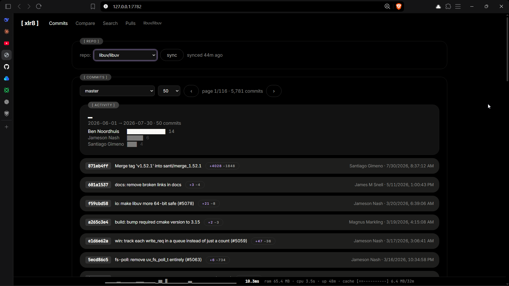
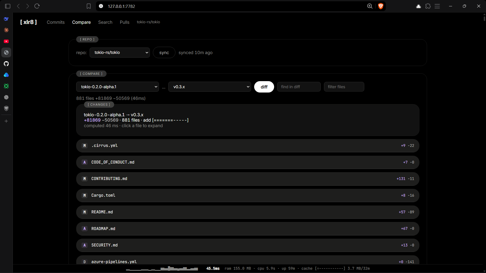
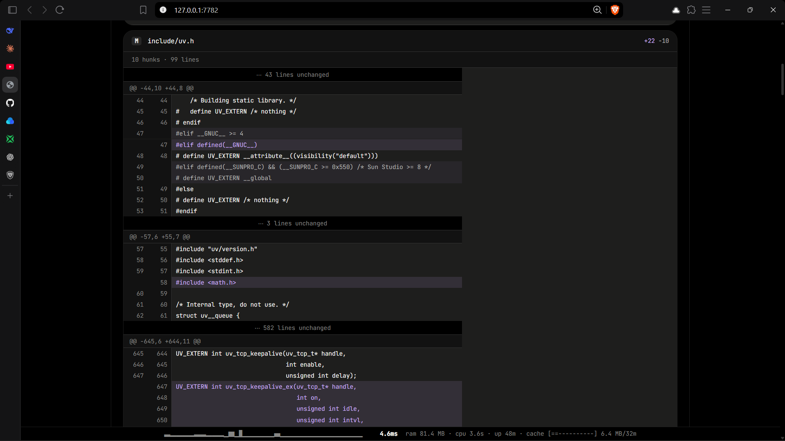
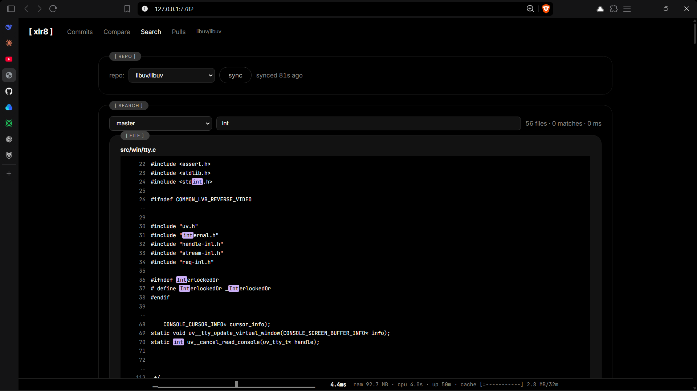

# xlr8

**GitHub in a box: instant local web viewer for any repo.**
One command, one ~5 MB binary. Commits, compare, search and PRs, served from your own machine. Runs on Windows, Linux, and even a phone (Termux).

```
xlr8 owner/repo
```

- **Repeat views in ~0.1 ms.** Results are cached in memory and on disk, so they survive restarts.
- **First compare 1.7–4.8× faster than `git diff`** on 7 of 8 benchmark ranges (16 threads, Windows).
- **Git-accurate.** Exact totals on synthetic ranges, within 0.16% on real repos, identical rename pairs.



<p align="center"><sub>tokio: 4,783 commits, browsed locally</sub></p>

<table>
  <tr>
    <td></td>
    <td></td>
  </tr>
  <tr>
    <td align="center"><sub>tokio, 881 files compared in ~46 ms</sub></td>
    <td align="center"><sub>GitHub-style diffs</sub></td>
  </tr>
  <tr>
    <td colspan="2"></td>
  </tr>
  <tr>
    <td colspan="2" align="center"><sub>Fuzzy path search and in-repo grep across the whole tree, with a blob viewer</sub></td>
  </tr>
</table>

## Install

```
git clone https://github.com/Banshal-Yadav/xlr8.git
cd xlr8
cargo build --release
```

Binary: `target/release/xlr8` (~5 MB). Requires the Rust toolchain ([rustup](https://rustup.rs)).

## Usage

```
xlr8 owner/repo --port 7782     # open one repo
xlr8 --serve --port 7782        # serve all previously opened repos
```

Opens `http://127.0.0.1:7782`. The repo is mirrored to `~/.cache/xlr8/mirrors/` and synced on request.
Flags: `--port <p>` (default 7782) · `--serve` (multi-repo) · `--no-open` (don't launch browser).

## What it does

- **Commits**: paginate, per-commit +/−, activity strip, author rank
- **Compare**: rename detection, edit-script diffs, windowed rendering
- **Search**: fuzzy path matching, in-repo grep, blob viewer
- **Pulls**: browse open PRs
- **Perf bar**: live latency sparkline, cache meter, RAM/CPU

## Performance

**Windows 11 · Ryzen 7 7735HS (8C/16T) · NVMe.** Medians. Baseline is
`git diff --numstat -M` on the same packed mirror (includes process spawn);
xlr8 times are full HTTP round-trips with JSON. Cold = fresh process, all
caches wiped (5 runs). Warm = 100 repeats over a keep-alive connection.

| Range                            | Files | git    | xlr8 cold     | cold, 1 thread | warm    |
| -------------------------------- | ----- | ------ | ------------- | -------------- | ------- |
| ripgrep 14.1..15.1               | 91    | 45 ms  | 63 ms (0.7×)  | 77 ms (0.6×)   | 0.09 ms |
| ripgrep 0.1..15.2                | 252   | 65 ms  | 28 ms (2.4×)  | 49 ms (1.3×)   | 0.11 ms |
| tokio 1.0..1.53                  | 867   | 115 ms | 30 ms (3.8×)  | 122 ms (1.0×)  | 0.12 ms |
| libuv v1.0..v1.53                | 495   | 93 ms  | 40 ms (2.3×)  | 82 ms (1.2×)   | 0.11 ms |
| stress, deep deltas (synthetic)  | 2000  | 59 ms  | 32 ms (1.8×)  | 219 ms (0.3×)  | 0.15 ms |
| 20k-line file (synthetic)        | 2002  | 69 ms  | 27 ms (2.5×)  | 26 ms (2.5×)   | 0.13 ms |
| +1M lines added (synthetic)      | 2500  | 121 ms | 70 ms (1.7×)  | 121 ms (1.0×)  | 0.19 ms |
| ±250k lines modified (synthetic) | 1250  | 110 ms | 23 ms (4.8×)  | 83 ms (1.4×)   | 0.11 ms |

- **Repeat views are effectively free:** ~0.1 ms from memory; compare results are also cached on disk by commit OID.
- **First views beat git on 7 of 8 ranges** with the default thread count. Single-threaded, cold is roughly on par with git, so most of the cold margin comes from parallel diffing.
- **Known weak spots:** very small ranges and single-threaded deep delta chains.

Full tables, per-run numbers and method: [`docs/BENCHMARKS.md`](docs/BENCHMARKS.md).

### Also runs on a phone

xlr8 runs on Android via Termux (tested on a Snapdragon 695 / Poco X4 Pro 5G,
aarch64). Early numbers from that device are in [`docs/benchmark.md`](docs/benchmark.md);
they use an older harness and PRoot, so they are not comparable to the
table above.

## HTTP API

- `GET /api/{owner}/{repo}/refs` — branches, tags
- `GET /api/{owner}/{repo}/commits?limit=N&ref=REF&stats=1&count=1` — commit list
- `GET /api/{owner}/{repo}/diff?base=REF&head=REF` — compare summary (+/− per file)
- `GET /api/{owner}/{repo}/search?q=...` — path + grep search
- `GET /api/{owner}/{repo}/file?base=...&head=...&path=...` — file diff/hunks
- `GET /api/repos` — list mirrored repos
- `GET /api/stats` — runtime stats (RSS, CPU, cache, uptime)

## Built with

[gix](https://github.com/GitoxideLabs/gitoxide) · [axum](https://github.com/tokio-rs/axum) · [tokio](https://github.com/tokio-rs/tokio) · [imara-diff](https://github.com/Byron/imara-diff) · vanilla HTML/JS

## License

MIT © 2026 Banshal-Yadav